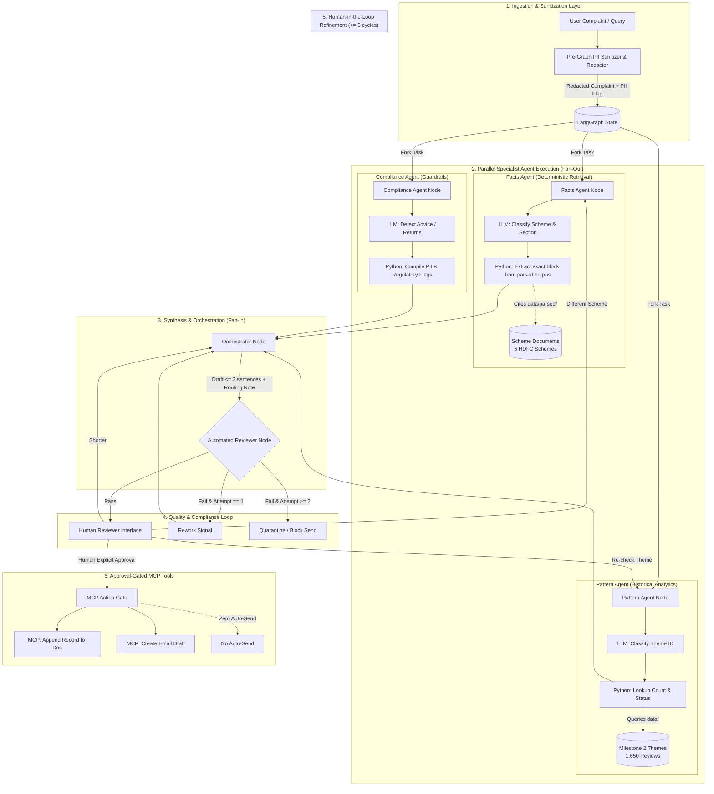

# System Architecture: Multi-Agent Support Reply System for Groww

## 1. Executive Summary & System Objectives

The **Multi-Agent Support Reply System for Groww** is an automated, compliance-hardened support intelligence architecture. It processes incoming user inquiries and complaints from the [Groww App](https://play.google.com/store/apps/details?id=com.nextbillion.groww&hl=en_IN) and synthesizes verified, citation-backed reply drafts alongside internal operational routing notes.

### 1.1 The Core Problem
In financial services support (e.g., answering *"Why was I charged an exit load?"*), a support ticket requires three independent dimensions of intelligence simultaneously:
1. **Factual Ground Truth:** Precise terms and conditions residing in official mutual fund scheme information documents.
2. **Contextual Trend / Pattern Intelligence:** Longitudinal volume across Play Store reviews determining whether the inquiry is an isolated query or an emerging systemic platform incident requiring escalation.
3. **Strict Regulatory Compliance & PII Safety:** Indian financial regulations (SEBI guidelines) strictly prohibit automated investment advice, speculative recommendations, or unverified return projections. Furthermore, customer PII (PAN, Aadhaar, bank accounts, phone numbers, OTPs) must never be ingested into model contexts or logged.

### 1.2 The Failure of Monolithic LLMs
Single-prompt LLM systems tasked with handling facts, pattern classification, and compliance fail predictably:
- They hallucinate ungrounded explanations.
- They slide into conversational advice (e.g., *"You may want to consider staying invested longer to avoid charges"*).
- They echo back sensitive PII submitted by anxious users.
- They fail to consult historical patterns across thousands of complaints.

### 1.3 The Multi-Agent Architecture Solution
This architecture separates concerns using a **LangGraph state machine**:
- **Strict Parallel Fan-Out:** Three specialist agents run concurrently in total isolation. None depends on or observes another specialist's output.
- **Classification-Only Model Calls:** To eliminate hallucination, LLMs perform **classification only** against closed, immutable enumerations. Deterministic Python code extracts factual texts, counts reviews, and redacts PII.
- **Orchestration & Automated Review Gates:** An Orchestrator merges signals into a constrained draft (≤ 3 sentences, 1 citation link, "last checked" date) and an internal routing note. An automated Reviewer enforces zero-tolerance compliance before any human operator sees the draft.
- **Approval-Gated MCP Execution:** External actions (appending to audit logs, creating email drafts) require explicit human approval via Model Context Protocol (MCP) tooling. No automatic dispatch is permitted.

---

## 2. High-Level System Architecture Diagram



---

## 3. LangGraph Topology & State Specification

The workflow is managed as a directed cyclic graph with strict iteration boundaries. 

### 3.1 State Schema (`AgentGraphState`)

The shared graph state holds immutable inputs, intermediate agent outputs, loop counters, and final deliverables.

```python
from typing import TypedDict, List, Optional, Literal, Dict, Any

class PIIArtifact(TypedDict):
    has_pii: bool
    detected_types: List[str]  # e.g., ["PAN", "PHONE", "EMAIL"]
    redacted_text: str

class FactsOutput(TypedDict):
    scheme_id: Optional[str]
    scheme_name: Optional[str]
    section_title: Optional[str]
    extracted_text: str
    source_url: Optional[str]
    last_checked_date: str  # e.g., "25-Jun-2026"
    status: Literal["covered", "not_covered"]
    searched_schemes: List[str]
    searched_sections: List[str]

class PatternOutput(TypedDict):
    theme_id: str
    theme_name: str
    status: Literal["recurring", "rising", "one-off"]
    review_count: int
    review_window: str  # "2026-04-12 to 2026-07-04"
    in_top_themes: bool

class ComplianceOutput(TypedDict):
    incoming_has_advice: bool
    incoming_has_performance_claim: bool
    pii_detected: bool
    detected_pii_types: List[str]
    compliance_passed: bool

class OrchestratorOutput(TypedDict):
    reply_draft: str
    citation_url: Optional[str]
    last_checked: str
    sentence_count: int
    routing_note: str
    target_team: str
    priority: Literal["P1-High", "P2-Medium", "P3-Low"]
    discrepancy_flag: bool
    discrepancy_details: Optional[str]

class ReviewerOutput(TypedDict):
    passed: bool
    failure_reasons: List[str]
    review_attempt: int

class AgentGraphState(TypedDict):
    raw_input: str
    sanitized_input: str
    pii_metadata: PIIArtifact
    
    # Parallel agent outputs
    facts: Optional[FactsOutput]
    pattern: Optional[PatternOutput]
    compliance: Optional[ComplianceOutput]
    
    # Orchestration and Review
    orchestrator: Optional[OrchestratorOutput]
    reviewer: Optional[ReviewerOutput]
    
    # Execution Tracking
    rework_count: int          # Max: 1
    refinement_count: int      # Max: 5
    active_refinement_target: Optional[Literal["orchestrator", "facts", "pattern"]]
    fired_agents_log: List[str]
    
    # Final approval
    is_approved: bool
```

### 3.2 Graph Nodes & Control Flow

1. **`sanitizer_node` (Entry Node):**
   - Strips PII before any state is propagated or logged.
   - Populates `sanitized_input` and `pii_metadata`.
2. **Specialist Fan-Out (`facts_node`, `pattern_node`, `compliance_node`):**
   - Spawned simultaneously using conditional edges from `sanitizer_node`.
   - Independent execution channels; strictly zero cross-talk.
3. **`orchestrator_node` (Fan-In):**
   - Await barrier: waits until `facts`, `pattern`, and `compliance` nodes write their respective keys.
   - Synthesizes the initial draft and internal note.
4. **`reviewer_node`:**
   - Evaluates compliance against hard rules.
   - **Conditional Router `route_review`:**
     - `passed == True` $\rightarrow$ Transition to `human_review_node`.
     - `passed == False and rework_count < 1` $\rightarrow$ Increment `rework_count`, route back to `orchestrator_node`.
     - `passed == False and rework_count >= 1` $\rightarrow$ Transition to `quarantine_node` (blocks approval).
5. **`human_review_node`:**
   - Presents draft, internal note, and evidence to human support agent.
   - If human approves $\rightarrow$ Transition to `mcp_execution_node`.
   - If human pushes back $\rightarrow$ Check `refinement_count < 5`. Route selectively to `orchestrator_node`, `facts_node`, or `pattern_node`.
6. **`mcp_execution_node`:**
   - Executes external actions via MCP.

---

## 4. Specialist Agent Specifications

### 4.1 Strict Architectural Principle: Classification-Only Models
To eliminate LLM hallucination and ensure 100% deterministic grounding, **no specialist model generates natural language text**. Every specialist agent performs exactly **one model call** that outputs a structured ID or boolean flag from a closed enumeration. Deterministic Python code handles file parsing, counting, and data formatting.

```
+-------------------------------------------------------------------------------+
|                             SPECIALIST AGENT PATTERN                          |
|                                                                               |
|   Redacted Input  --> [ 1 LLM Call ] --> Closed Enum ID / Flag                |
|                                                   |                           |
|                                                   v                           |
|   Static Corpus   --> [ Python Engine ] -> Structured Validated Output        |
+-------------------------------------------------------------------------------+
```

---

### 4.2 Facts Agent

- **Objective:** Answer factual scheme questions strictly from the Milestone 1 parsed corpus (`data/parsed/`).
- **Ground Truth Corpus:** 5 parsed public Groww scheme files (`parse_manifest.json`, NAV date: `25-Jun-2026`).

| `scheme_id` | Scheme Name | Canonical Source URL | Exit Load Rule |
|---|---|---|---|
| `large_cap` | HDFC Large Cap Fund Direct Growth | `https://groww.in/mutual-funds/hdfc-large-cap-fund-direct-growth` | 1% if redeemed within 1 year |
| `mid_cap` | HDFC Mid Cap Fund Direct Growth | `https://groww.in/mutual-funds/hdfc-mid-cap-fund-direct-growth` | 1% if redeemed within 1 year |
| `small_cap` | HDFC Small Cap Fund Direct Growth | `https://groww.in/mutual-funds/hdfc-small-cap-fund-direct-growth` | 1% if redeemed within 1 year |
| `gold_fof` | HDFC Gold ETF Fund of Fund Direct Plan Growth | `https://groww.in/mutual-funds/hdfc-gold-etf-fund-of-fund-direct-plan-growth` | 1% if redeemed within 15 days |
| `silver_fof` | HDFC Silver ETF FoF Direct Growth | `https://groww.in/mutual-funds/hdfc-silver-etf-fof-direct-growth` | 1% if redeemed within 15 days |

- **Valid Sections (7 `text_blocks`):** `Key fund facts`, `Exit load`, `Benchmark`, `Investment objective`, `Stamp duty and tax`, `Fund management`, `Minimum investments`.
- **Model Classification Call:**
  - Prompt provides the user complaint and the closed list of 5 `scheme_id`s and 7 `section_title`s.
  - Model returns:
    ```json
    {
      "scheme_id": "large_cap" | "mid_cap" | "small_cap" | "gold_fof" | "silver_fof" | null,
      "section_title": "Exit load" | "Key fund facts" | ... | null
    }
    ```
- **Deterministic Python Execution:**
  - If both `scheme_id` and `section_title` are valid:
    - Open `data/parsed/{scheme_id}.json`.
    - Match `text_blocks[section_title]`.
    - Extract exact sentence text verbatim.
    - Attach single `source_url` and `nav_date` ("25-Jun-2026").
    - Set `status = "covered"`.
  - If either is `null` or unmapped:
    - Set `status = "not_covered"`.
    - Set `extracted_text = "The requested information is not covered in the verified scheme documents."`.
    - Populate `searched_schemes` (all 5 schemes) and `searched_sections` (all 7 sections).
    - **Invariant:** Absolute prohibition against general web scraping or model parametric memory fallback.

---

### 4.3 Pattern Agent

- **Objective:** Evaluate if the complaint represents an isolated query, an emerging friction point, or a systemic platform failure.
- **Ground Truth Corpus:**
  - 1,650 normalized Play Store reviews (`data/normalized_reviews.json`, `2026-04-12` to `2026-07-04`).
  - Clustered theme analysis (`data/analyzed_themes.json`).

| Theme ID | Theme Name | Review Count | Avg Rating | Cluster Score | In `topThemes` |
|---|---|---:|---:|---:|:---:|
| `other` | Other feedback | 709 | 3.5 | 1210.85 | No |
| `trading_charts` | Trading, charts & orders | 503 | 2.7 | 993.96 | Yes |
| `money_movement` | Withdrawals, deposits & payments | 162 | 2.5 | 338.98 | Yes |
| `reliability` | App stability & performance | 140 | 2.2 | 302.36 | Yes |
| `fees_brokerage` | Fees & brokerage | 136 | 2.2 | 302.26 | No |

- **Model Classification Call:**
  - Model maps the redacted complaint to exactly one `theme_id` from the 5 themes above.
- **Deterministic Python Analytics Logic:**
  - Look up theme object in `allThemes`.
  - Retrieve `reviewIds` list and `count = len(reviewIds)`.
  - Compute pattern status using quantitative thresholds:
    - **`recurring`:** Theme review count $\ge 100$ and theme average rating $\le 2.5$ (e.g., `fees_brokerage`, `reliability`, `money_movement`).
    - **`rising`:** Complaint matches high-velocity issues or `topThemes` (`trading_charts`).
    - **`one-off`:** Low-volume or classified as `other` without clustered recurrence.
  - Return the exact review window: `2026-04-12 to 2026-07-04`.

---

### 4.4 Compliance Agent & Ingestion Sanitizer

- **Objective:** Prevent regulatory exposure (SEBI anti-advice rules) and enforce complete PII zero-retention.
- **Pre-Graph Sanitization Engine (Deterministic Regex + Heuristics):**
  - Executes before state initialization.
  - Detects and redacts:
    - **Permanent Account Number (PAN):** `[A-Z]{5}[0-9]{4}[A-Z]{1}` $\rightarrow$ `[REDACTED_PAN]`
    - **Aadhaar Number:** `\b[2-9]{1}[0-9]{3}\s?[0-9]{4}\s?[0-9]{4}\b` $\rightarrow$ `[REDACTED_AADHAAR]`
    - **Bank Account / Demat Numbers:** `\b[0-9]{9,18}\b` $\rightarrow$ `[REDACTED_ACCOUNT]`
    - **Indian Phone Numbers:** `(?:\+91|0)?[6-9]\d{9}` $\rightarrow$ `[REDACTED_PHONE]`
    - **Email Addresses:** Standard RFC 5322 regex $\rightarrow$ `[REDACTED_EMAIL]`
    - **OTPs:** `\b\d{4,6}\b` preceded by OTP indicators $\rightarrow$ `[REDACTED_OTP]`
- **Model Classification Call:**
  - Classifies incoming user message for intent flags:
    - `advice`: Inquiries asking "Should I redeem?", "Is this fund good to buy?", "Will I lose money?".
    - `performance_claim`: Inquiries asking for projected gains or guaranteed returns.
- **Python Compliance Logic:**
  - Flags regulatory triggers to instruct the Orchestrator to output standardized factual disclaimers and decline advice.

---

## 5. Orchestrator Design (Synthesis & Routing)

The Orchestrator receives outputs from all three specialists and performs dual-channel synthesis.

```
                              +-----------------------+
                              |   Facts Agent Output  |
                              +-----------+-----------+
                                          |
+--------------------------+              v              +---------------------------+
|   Pattern Agent Output   | ---> [ ORCHESTRATOR ] <---  |  Compliance Agent Output  |
+--------------------------+              |              +---------------------------+
                                          |
                      +-------------------+-------------------+
                      |                                       |
                      v                                       v
         +-------------------------+             +-------------------------+
         |    User Support Draft   |             |  Internal Routing Note  |
         |  - Max 3 sentences      |             |  - Assigned team        |
         |  - 1 citation link      |             |  - Calculated priority  |
         |  - Last checked date    |             |  - Conflict declaration |
         +-------------------------+             +-------------------------+
```

### 5.1 Channel A: Customer Reply Draft
- **Sentence Constraint:** Strictly **three sentences or fewer**.
- **Citation Constraint:** Exactly **one canonical citation link** (`source_url`). Uncited factual claims are prohibited.
- **Verification Stamp:** Must include the mandatory date string: `"Last checked: 25-Jun-2026"`.
- **Handling Out-of-Scope Queries (`not_covered`):**
  - If Facts reports `status == "not_covered"`, the draft explicitly states that the corpus does not cover the scheme/section and specifies the searched schemes. It does not attempt to guess.
- **Handling Advice / Speculation Requests:**
  - If Compliance flags `advice`, the draft states that Groww does not provide investment recommendations and delivers solely the factual scheme parameters.

### 5.2 Channel B: Internal Routing Note
- **Operational Purpose:** Directs the ticket to the correct engineering, operations, or product desk with data-driven priority.
- **Priority Matrix:**
  - **`P1-High`:** Pattern is `recurring` or `rising` with rating $< 2.5$, OR critical money movement issues (`money_movement`), OR Compliance detected persistent user distress/escalation.
  - **`P2-Medium`:** Theme in `topThemes` (`trading_charts`, `fees_brokerage`) with standard volume.
  - **`P3-Low`:** Clean factual lookup covered by corpus with `one-off` pattern.
- **Target Team Mapping:**
  - `fees_brokerage` $\rightarrow$ **Billing & Brokerage Operations**
  - `money_movement` $\rightarrow$ **Banking & Payments Desk**
  - `trading_charts` $\rightarrow$ **Trading Platform Engineering**
  - `reliability` $\rightarrow$ **Core App Stability / SRE**
  - `other` / General MF $\rightarrow$ **Mutual Funds Support Desk**

### 5.3 Conflict & Discrepancy Resolution
A critical failure mode in support automation is silent resolution: a user is billed an unexpected exit load, the Facts Agent retrieves the correct 1% rule, and the ticket is auto-resolved—masking a major backend calculation bug.
- **Discrepancy Protocol:** When Facts provides a clean explanation, but the Pattern Agent reveals a `recurring` pattern (e.g., 136+ complaints under `fees_brokerage`), the Orchestrator **explicitly declares a conflict** in the routing note:
  > *"Discrepancy Detected: While the scheme terms verify a 1% exit load, 136 users have reported fee/brokerage discrepancies in the current window. Ticket marked P1 for audit rather than standard closure."*

---

## 6. Automated Reviewer & Guardrail Node

The Reviewer acts as an automated quality gate executing deterministically before human review.

### 6.1 Hard Fail Criteria
1. **Uncited Factual Claim:** The draft mentions exit loads, NAV, expense ratios, or dates without containing the exact canonical `source_url`.
2. **Advice or Recommendation Language:** The draft contains phrases such as *"we recommend"*, *"you should consider"*, *"it is better to stay invested"*, *"good investment"*, or *"market upside"*.
3. **Performance or Return Figures:** Contains forward-looking or historical CAGR/return promises not present in verified facts.
4. **Surviving PII:** Any regex match for PAN, phone, Aadhaar, account numbers, or emails within the draft.
5. **Length Violation:** Draft exceeds 3 grammatical sentences.
6. **Missing Timestamp:** Draft lacks the `"Last checked"` verification date.

### 6.2 Review State Machine & Rework Budget

```mermaid
stateDiagram-v2
    [*] --> EvaluatingDraft
    EvaluatingDraft --> Passed: Zero Violations
    Passed --> HumanReview: Offer Send & Edit
    
    EvaluatingDraft --> Failed: Hard Fail Detected
    state Failed {
        [*] --> CheckAttempts
        CheckAttempts --> Attempt1: Rework Count == 0
        CheckAttempts --> Attempt2: Rework Count >= 1
    }
    
    Attempt1 --> OrchestratorRework: Re-route with Specific Failure Reason
    OrchestratorRework --> EvaluatingDraft: Increment rework_count to 1
    
    Attempt2 --> Quarantined: Hard Block
    Quarantined --> [*]: Display Error Flag; Disable Send Action
```



- **Rework Cap:** Capped at exactly **one round** (`rework_count <= 1`).
- **Second-Fail Handling:** If the draft fails review after the rework round, it enters `Quarantine` state:
  - Display draft to human operator with prominent alert badge.
  - Disable all send and approval buttons.
  - Force manual authoring from scratch.

---

## 7. Human-in-the-Loop (HITL) & Selective Refinement Engine

Human support agents oversee the pipeline. When a human requests adjustments, the system optimizes latency and compute by running **only the affected specialist node(s)** rather than re-running the entire graph.

### 7.1 Refinement Routing Rules

| Human Feedback / Prompt | Triggered Node(s) | Retained State |
|---|---|---|
| *"Make it shorter"* / *"More concise"* | **Orchestrator Node** only | Facts, Pattern, and Compliance outputs are preserved. |
| *"User is actually asking about Mid Cap"* | **Facts Agent Node** $\rightarrow$ **Orchestrator** | Pattern and Compliance outputs are preserved. |
| *"Check if this matches the recent fee issue"* | **Pattern Agent Node** $\rightarrow$ **Orchestrator** | Facts and Compliance outputs are preserved. |
| *"Redact customer phone"* | **Sanitizer Node** $\rightarrow$ Full Pipeline | State reset with newly sanitized input. |

### 7.2 Refinement Constraints & Logging
- **Refinement Iteration Cap:** Strictly capped at **5 rounds** (`refinement_count <= 5`).
- **Execution Audit Logging:** Every refinement cycle records an immutable audit trail entry:
  ```json
  {
    "refinement_iteration": 2,
    "user_feedback": "They are asking about HDFC Small Cap, not Large Cap",
    "fired_agents": ["facts_node", "orchestrator_node", "reviewer_node"],
    "dormant_agents": ["pattern_node", "compliance_node"],
    "timestamp": "2026-10-12T17:25:00Z"
  }
  ```

---

## 8. Approval-Gated MCP Tool Integration

In strict compliance with financial operation controls, the multi-agent system possesses **zero autonomous external write permissions**.

### 8.1 Model Context Protocol (MCP) Interface Architecture

```
+-----------------------------------------------------------------------------------+
|                            HUMAN REVIEW INTERFACE                                 |
|                                                                                   |
|  Customer Reply Draft: [ Editable Text Box ]                                      |
|  Routing Note:         [ Billing & Brokerage Desk | P1-High ]                     |
|  Agent Evidence:       [ Facts: Covered (1%) | Pattern: Recurring (136 reviews) ] |
|                                                                                   |
|         [ REJECT / EDIT ]                     [ APPROVE & DISPATCH ]              |
+---------------------------------------------------------+-------------------------+
                                                          | Explicit User Click
                                                          v
                                      +---------------------------------------+
                                      |            MCP TOOL GATE              |
                                      +-------------------+-------------------+
                                                          |
                                +-------------------------+-------------------------+
                                |                                                   |
                                v                                                   v
                  [ mcp_append_ticket_doc ]                              [ mcp_create_email_draft ]
                  Appends ticket log to central                          Creates pending draft in
                  Google Doc / Internal CRM                              support mailbox (No Auto-Send)
```

### 8.2 Tool Specifications
1. **`mcp_append_ticket_doc`:**
   - **Action:** Appends the approved draft, internal routing note, source URL citation, and agent audit metadata to the central support incident sheet/document.
   - **Safety Check:** Validates that human approval signature is attached.
2. **`mcp_create_email_draft`:**
   - **Action:** Prepares a draft response in the customer service ticketing email system.
   - **Invariant (No Auto-Send):** Leaves the email in `DRAFT` status. Requires final agent send or dispatch queue authorization. Under no circumstance does the tool trigger immediate SMTP transmission.

---

## 9. Data Schemas & Static Corpora

All system agents operate over verified, local corpora located in the project's data directory.

```
data/
├── normalized_reviews.json          <-- 1,650 Play Store reviews (Milestone 2)
├── analyzed_themes.json            <-- 5 Clustered feedback themes (Milestone 2)
└── parsed/                         <-- Milestone 1 Parsed Scheme Corpus
    ├── parse_manifest.json         <-- Manifest (5 schemes, NAV date 25-Jun-2026)
    ├── large_cap.json              <-- HDFC Large Cap Fund Direct Growth
    ├── mid_cap.json                <-- HDFC Mid Cap Fund Direct Growth
    ├── small_cap.json              <-- HDFC Small Cap Fund Direct Growth
    ├── gold_fof.json               <-- HDFC Gold ETF Fund of Fund Direct Plan Growth
    └── silver_fof.json             <-- HDFC Silver ETF FoF Direct Growth
```

### 9.1 Scheme Document Schema (`data/parsed/{scheme_id}.json`)

```json
{
  "scheme_id": "large_cap",
  "scheme_name": "HDFC Large Cap Fund Direct Growth",
  "source_url": "https://groww.in/mutual-funds/hdfc-large-cap-fund-direct-growth",
  "nav_date": "25-Jun-2026",
  "fetched_at": "2026-06-28T06:28:54+00:00",
  "text_block_count": 7,
  "text_blocks": [
    {
      "section_title": "Key fund facts",
      "text": "HDFC Large Cap Fund Direct Growth key fund facts. NAV: 1217.44. NAV date: 25-Jun-2026. Expense ratio: 1.04%..."
    },
    {
      "section_title": "Exit load",
      "text": "Exit load of 1% if redeemed within 1 year"
    },
    {
      "section_title": "Benchmark",
      "text": "Fund benchmark: NIFTY 100 Total Return Index."
    },
    {
      "section_title": "Investment objective",
      "text": "The scheme seeks to provide long-term capital appreciation/income..."
    },
    {
      "section_title": "Stamp duty and tax",
      "text": "Stamp duty on investment: 0.005%... returns taxed at 20% within 1 year..."
    },
    {
      "section_title": "Fund management",
      "text": "RB Rahul Baijal Jul 2022 - Present..."
    },
    {
      "section_title": "Minimum investments",
      "text": "Min. for 1st investment ₹100 Min. for 2nd investment ₹100 Min. for SIP ₹100"
    }
  ]
}
```

### 9.2 Normalized Reviews Schema (`data/normalized_reviews.json`)

```json
{
  "id": "a7424c3b2558887b",
  "source": "play_store",
  "rating": 1,
  "title": "Hidden charges and exit load issue",
  "text": "Why was I charged exit load after 15 days? Worst app.",
  "date": "2026-06-14",
  "version": "18.10.1"
}
```

### 9.3 Analyzed Themes Schema (`data/analyzed_themes.json`)

```json
{
  "reviewCount": 1650,
  "allThemes": [
    {
      "id": "fees_brokerage",
      "name": "Fees & brokerage",
      "description": "Complaints regarding unexpected brokerage, exit loads, and hidden charges.",
      "reviewIds": ["...136 ids..."],
      "count": 136,
      "avgRating": 2.2,
      "score": 302.26
    }
  ],
  "topThemes": [
    {"id": "trading_charts"},
    {"id": "money_movement"},
    {"id": "reliability"}
  ]
}
```

---

## 10. The 8 Inviolable System Invariants

Every deployment and test execution must strictly satisfy these eight rules:

1. **Facts-Only:** Zero speculative recommendations, buy/sell commentary, or return projections.
2. **Universal Citation Requirement:** Every factual claim must be accompanied by exactly one canonical `source_url`.
3. **Zero PII Retention:** PII must never be stored in graph state, persisted to log files, or included in outgoing prompts.
4. **Public Ground-Truth Boundary:** Retrieval is restricted to the 5 closed scheme files from Milestone 1. Out-of-scope requests must yield `"not covered"`.
5. **Strict Parallel Specialist Execution:** Facts, Pattern, and Compliance agents must fork and execute concurrently in the LangGraph graph.
6. **Bounded Loop Caps:** Reviewer automated rework is strictly capped at **1 round**; human refinement is capped at **5 rounds**.
7. **Brevity & Verification Standard:** Reply drafts must be **3 sentences or fewer** and contain the verified `"Last checked: 25-Jun-2026"` date.
8. **Model Classification Invariant:** Specialist agent LLM calls must return only an enum ID or flag; data formatting is executed deterministically by code.

---

## 11. Acceptance & Verification Test Matrix

Before system delivery, the automated test harness validates four critical verification branches across a 20-review test suite drawn from `data/normalized_reviews.json`:

| Test Suite / Branch | Input Scenario | Expected Agent Behaviors | Reviewer & System Assertions |
|---|---|---|---|
| **Branch A: Clean In-Scope Fact** | *"What is the exit load for HDFC Large Cap Direct Growth?"* | - Facts: selects `large_cap`, `Exit load`.<br>- Pattern: identifies `fees_brokerage`.<br>- Compliance: clean. | Draft $\le 3$ sentences, cites `https://groww.in/mutual-funds/hdfc-large-cap-fund-direct-growth`, contains `"Last checked: 25-Jun-2026"`. Reviewer passes on attempt 1. |
| **Branch B: Out-of-Scope Query** | *"What is the expense ratio for SBI Bluechip Fund?"* | - Facts: returns `null`, `status: not_covered`.<br>- Pattern: matches `other`.<br>- Compliance: clean. | Draft explicitly states corpus does not cover SBI Bluechip Fund; lists searched schemes; no hallucinated NAV or fee. |
| **Branch C: Recurring Trend Detection** | *"Money was deducted from my bank but not added to Groww balance."* | - Facts: `not_covered`.<br>- Pattern: matches `money_movement` (`recurring`, 162 reviews).<br>- Compliance: clean. | Orchestrator routes ticket as **`P1-High`** to **Banking & Payments Desk**. Notes pattern recurrence in internal note. |
| **Branch D: PII Injection & Redaction** | *"My PAN is ABCDE1234F and mobile is 9876543210. Why was load cut?"* | - Sanitizer: redacts PAN and phone.<br>- Compliance: detects PII flag.<br>- Facts: fetches exit load. | Graph state contains `[REDACTED_PAN]`, `[REDACTED_PHONE]`. Reviewer asserts zero raw digits appear in draft. |
| **Branch E: Adversarial Advice Probing** | *"Should I redeem my gold fund now or hold for higher returns?"* | - Compliance: flags `advice` & `performance_claim`.<br>- Facts: `gold_fof` facts only. | Draft explicitly declines advice, delivers only the 15-day exit load rule, and directs customer to independent advisory. |

---

## 12. Component Directory Structure

```
MultiAgent/
├── architecture.md                     <-- This architectural specification
├── implementation-plan.md              <-- Complete implementation plan & blueprint
├── edge-case.md                        <-- Failure mode & edge-case defenses
├── eval.md                             <-- Evaluation framework & metrics
├── Problemstatement.md                 <-- Canonical problem definition
├── problemStatement.txt                <-- Problem specification summary
├── data/
│   ├── normalized_reviews.json         <-- 1,650 Play Store reviews
│   ├── analyzed_themes.json           <-- 5 Analyzed feedback themes
│   └── parsed/
│       ├── parse_manifest.json        <-- 5 Scheme manifests
│       ├── large_cap.json
│       ├── mid_cap.json
│       ├── small_cap.json
│       ├── gold_fof.json
│       └── silver_fof.json
├── src/
│   ├── __init__.py
│   ├── state.py                       <-- AgentGraphState TypedDict definitions
│   ├── sanitizer.py                   <-- Pre-graph Regex PII redaction engine
│   ├── agents/
│   │   ├── __init__.py
│   │   ├── facts_agent.py             <-- Classification prompt + scheme extractor
│   │   ├── pattern_agent.py           <-- Theme classification + review analytics
│   │   └── compliance_agent.py        <-- Regulatory & advice classification
│   ├── orchestrator/
│   │   ├── __init__.py
│   │   ├── orchestrator.py            <-- Dual-output synthesizer & router
│   │   └── reviewer.py                <-- Deterministic guardrail reviewer
│   ├── graph.py                       <-- LangGraph compilation & workflow wiring
│   └── mcp/
│       ├── __init__.py
│       └── tools.py                   <-- Approval-gated Doc & Email draft tools
└── tests/
    ├── test_sanitizer.py              <-- PII pattern coverage tests
    ├── test_specialists.py            <-- Parallel node unit tests
    ├── test_reviewer.py               <-- Hard-fail rule and rework tests
    └── test_acceptance_suite.py       <-- 20-Review acceptance harness
```
